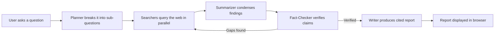

# System Overview

## What Problem Does This Application Solve?

Researching a topic on the web is time-consuming: a person must formulate search queries, sift through results, verify claims, and compile findings into a coherent report. This application automates the entire research workflow using a team of specialized AI agents that collaborate in real time.

## Why Was This Application Developed?

Manual web research suffers from three problems:

1. **Breadth** — a single query rarely covers all aspects of a topic.
2. **Accuracy** — raw search results contain noise and unverified claims.
3. **Presentation** — findings must be organized and cited before they are useful.

The Research Assistant Swarm addresses all three by decomposing a question, searching in parallel, summarizing, fact-checking, and writing a cited report — with zero manual intervention.

## Main Objectives

| Objective | How the Application Achieves It |
|---|---|
| Automated research planning | Planner agent decomposes queries into sub-questions |
| Broad web coverage | Parallel Searcher agents query Tavily simultaneously |
| Verified findings | Fact-Checker agent validates claims and triggers re-searches |
| Cited output | Writer agent produces a Markdown report with source links |
| Real-time visibility | SSE streaming shows each agent's progress live in the browser |

## Key Features

- Multi-agent orchestration with LangGraph `StateGraph` and parallel `Send` fan-out
- Live agent-activity streaming via Server-Sent Events
- Fact-check verification loop with configurable retry limit
- Single-page web UI with Tailwind CSS glassmorphism design
- Zero-database, in-memory request state
- Configurable LLM model, temperature, and search parameters via `.env`

## Target Users

- Researchers needing quick literature or topic surveys
- Developers exploring AI multi-agent patterns
- Students requiring cited summaries on complex topics

## High-Level Technology Stack

| Layer | Technology |
|---|---|
| Frontend | HTML, Tailwind CSS (CDN), Vanilla JavaScript, Marked.js |
| Backend | Python 3.12, FastAPI, Uvicorn, SSE-Starlette |
| AI Orchestration | LangGraph (StateGraph, Send, reducers) |
| LLM Provider | Groq (ChatGroq via langchain-groq) |
| Web Search | Tavily (TavilySearch via langchain-tavily) |
| Configuration | Pydantic Settings, python-dotenv |

## Overall Application Workflow

The application follows a linear pipeline with one conditional loop: the Fact-Checker can route back to the search phase when it identifies gaps in the research, up to a configurable retry limit (`MAX_FACTCHECK_RETRIES`, default 1).
