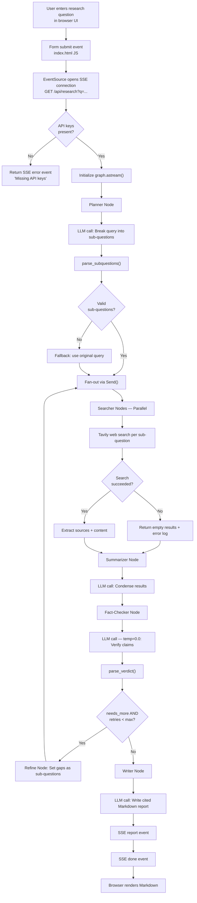
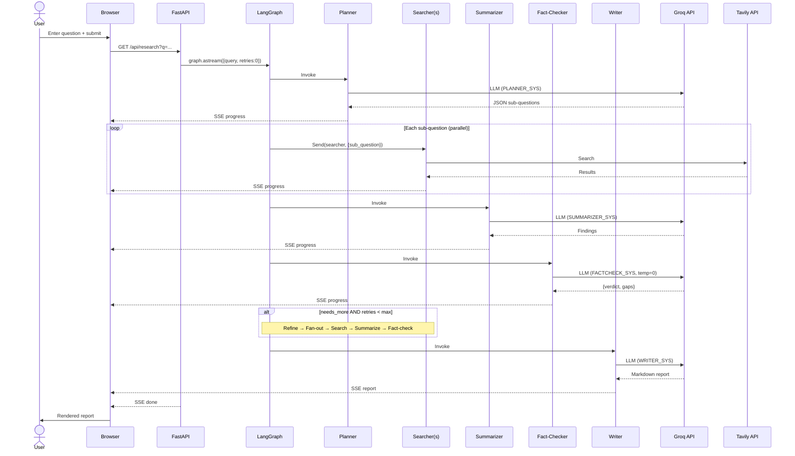
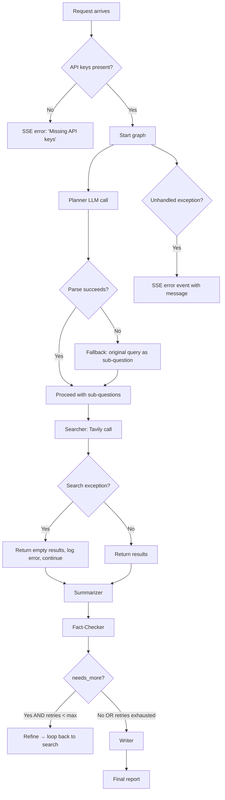

# End-to-End Application Flow

This document traces the complete lifecycle of a research request from user interaction to final report.

## 1. User Interaction

The user opens the browser at `http://127.0.0.1:8000`. The FastAPI server serves `static/index.html` via the `index()` route handler.

The UI presents:
- A search input field with a "Research" button
- Three example-question chips
- A pipeline visualization showing five agent cards (idle)
- An Activity log panel and a Report panel

The user types a question (minimum 3 characters) and submits the form.

## 2. Frontend Processing

```
index.html → form submit handler → run(query)
```

1. `run(query)` resets the UI: all agent cards set to "idle", log cleared, report placeholder shown.
2. Opens an `EventSource` connection to `/api/research?q=<encoded_query>`.
3. Registers listeners for four SSE event types: `progress`, `report`, `error`, `done`.

## 3. API Request and Backend Processing

```
GET /api/research?q=... → main.py → research() → event_gen()
```

| Step | Code Location | Action |
|---|---|---|
| Receive request | `main.py:research()` | FastAPI extracts `q` parameter (min 3 chars) |
| Validate keys | `event_gen()` → `settings.keys_present` | Checks `GROQ_API_KEY` and `TAVILY_API_KEY` |
| Start graph | `graph.astream({query, retries: 0})` | Initializes LangGraph with `custom` + `updates` stream modes |
| Stream events | Async generator yields SSE events | `progress`, `report`, `error`, `done` |

## 4. End-to-End Flow Diagram



## 5. Agent Pipeline Detail

### 5.1 Planner (`agents.planner`)

- **Input:** `state["query"]`
- **LLM prompt:** `PLANNER_SYS` — instructs the LLM to produce a JSON array of sub-questions.
- **Parsing:** `parse_subquestions()` extracts a JSON array; falls back to line-splitting on parse failure.
- **Fallback:** If no sub-questions are parsed, the original query is used as-is.
- **Output:** `{sub_questions: [...], retries: N}`
- **Progress events:** "Planning research for: ..." → "Drafted N sub-question(s)"

### 5.2 Fan-Out (`agents.fan_out_searches`)

- Returns `[Send("searcher", {query, sub_question})` for each sub-question.
- LangGraph invokes multiple `searcher` nodes in parallel.

### 5.3 Searcher (`agents.searcher`)

- **Input:** `state["sub_question"]`
- **Tool call:** `TavilySearch.ainvoke({query: sub_question})`
- **Error handling:** Catches all exceptions; returns empty results and logs the error.
- **Output:** Appends to `search_results` via the list-concatenation reducer (`operator.add`).
- **Progress events:** "Searching: ..." → "Found N source(s) for: ..."

### 5.4 Summarizer (`agents.summarizer`)

- **Input:** All `search_results` from state.
- **Context building:** Concatenates sub-question, sources, and content (truncated to 3000 chars per block).
- **LLM prompt:** `SUMMARIZER_SYS` — produce concise bullet points with source attribution.
- **Output:** `{summaries: [response]}`
- **Progress events:** "Summarizing findings from all searches" → "Key findings compiled"

### 5.5 Fact-Checker (`agents.fact_checker`)

- **Input:** `summaries` and `search_results` from state.
- **LLM prompt:** `FACTCHECK_SYS` — return `{verdict: "pass"|"needs_more", gaps: [...]}`.
- **Temperature:** Set to `0.0` for deterministic output.
- **Parsing:** `parse_verdict()` extracts the verdict; defaults to "pass" on parse failure.
- **Output:** `{verdict, gaps}`
- **Progress events:** "Verifying claims against sources" → "Verdict: ..."

### 5.6 Routing (`agents.route_after_factcheck`)

| Condition | Route |
|---|---|
| `gaps` is non-empty AND `retries < max_factcheck_retries` | → `refine` |
| Otherwise | → `writer` |

### 5.7 Refine (`agents.refine`)

- Sets `gaps` as the new `sub_questions`.
- Increments `retries` by 1.
- Flow loops back through `fan_out_searches` → `searcher` → `summarizer` → `fact_checker`.

### 5.8 Writer (`agents.writer_node`)

- **Input:** `summaries` and `search_results` from state.
- **Source deduplication:** Collects unique URLs via a `seen` set.
- **LLM prompt:** `WRITER_SYS` — write a Markdown report with inline citations and a Sources section.
- **Output:** `{report: markdown_string}`
- **Progress events:** "Writing final report" → "Report ready"

## 6. Sequence Diagram



## 7. SSE Event Flow

The FastAPI endpoint emits four event types:

| Event | Trigger | Payload |
|---|---|---|
| `progress` | Each agent emits via `get_stream_writer()` | `{agent, status, message, data?}` |
| `report` | Writer node completes; state contains `report` | `{report: "markdown..."}` |
| `error` | Missing API keys or unhandled exception | `{message: "error description"}` |
| `done` | Graph stream exhausted normally | `{}` |

The browser processes these events:
- `progress` → updates the agent pipeline card status and appends to the Activity log.
- `report` → renders Markdown via `marked.parse()` into the Report panel.
- `error` → logs the error and stops the stream.
- `done` → marks all agents as "done" and re-enables the submit button.

## 8. Error and Retry Flow



The application implements a resilient, non-crashing approach: individual search failures do not halt the pipeline, LLM parse failures trigger fallbacks, and all uncaught exceptions are caught at the SSE generator level and reported to the client.
