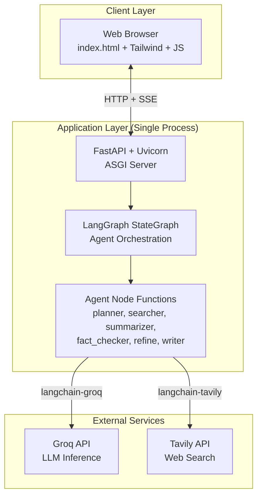
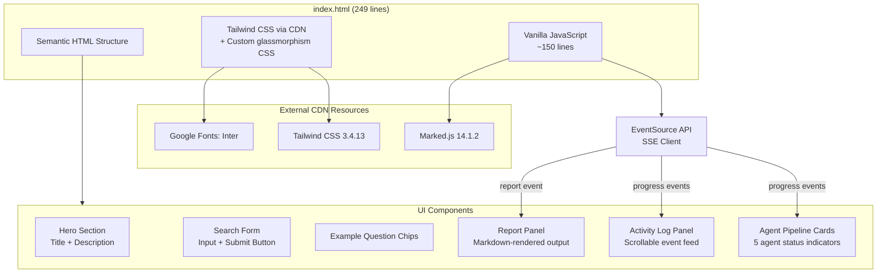
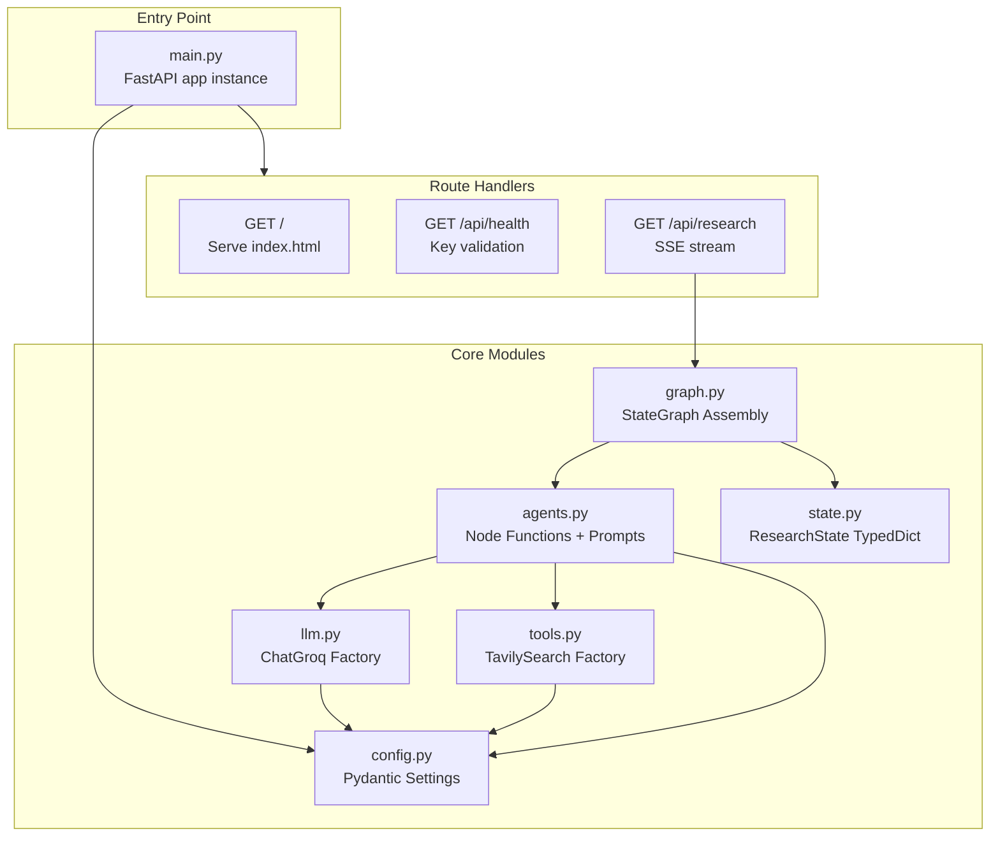
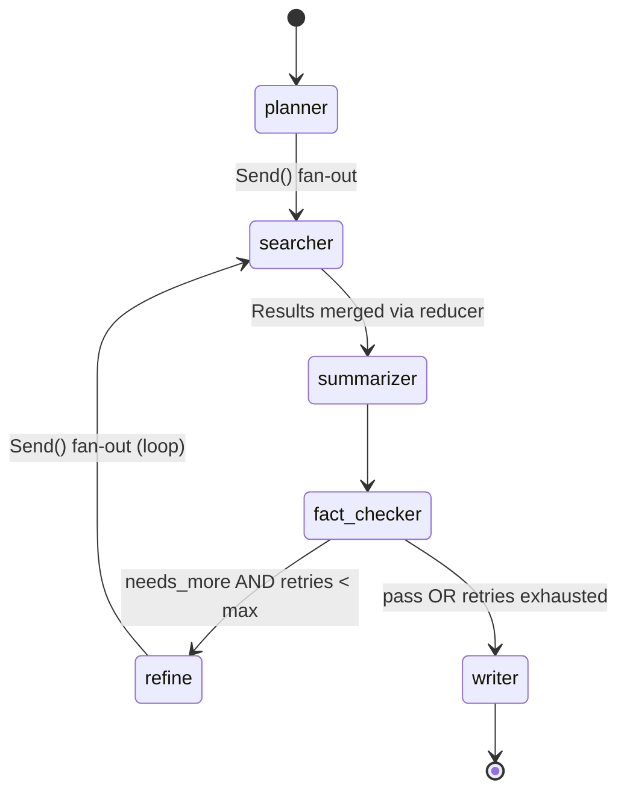
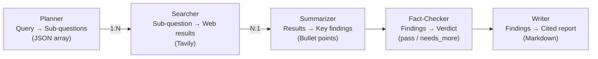
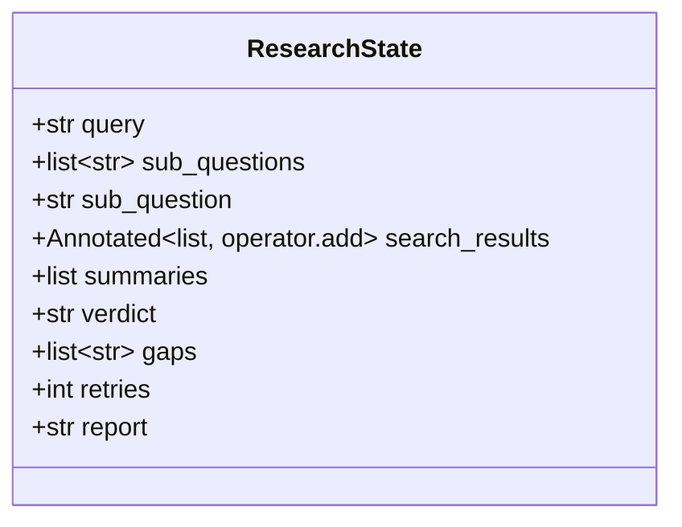
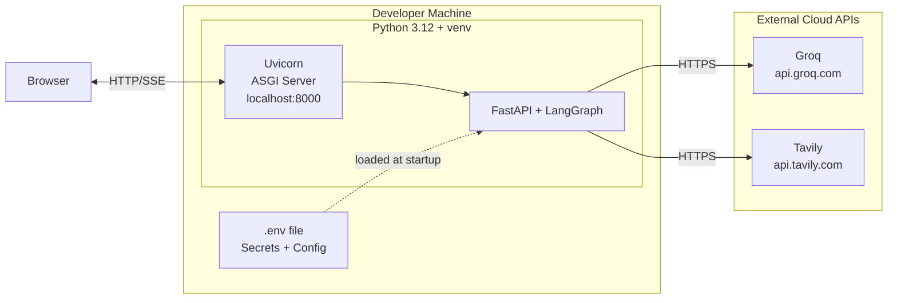

# System Architecture

## Overall Architecture

The application follows a **single-process, event-driven architecture** with an async Python backend serving a static single-page frontend. There is no database, no message queue, and no background workers — all state lives in-memory within the LangGraph execution context for the duration of a single request.

## Frontend Architecture

The frontend is a **single HTML file** (`static/index.html`) with no build step, no framework, and no bundler.

**Key design decisions:**
- No framework dependency — vanilla JS keeps the frontend zero-build and self-contained.
- Tailwind via CDN — avoids npm/node toolchain.
- `EventSource` for SSE — native browser API, no WebSocket library needed.
- `marked.js` renders the LLM-generated Markdown report on the client side.

## Backend Architecture

| Module | File | Responsibility |
|---|---|---|
| Configuration | `config.py` | Load `.env`, validate keys, export to `os.environ` |
| LLM Factory | `llm.py` | Create `ChatGroq` instances with configured model and temperature |
| Search Tool | `tools.py` | Create `TavilySearch` instances with configured result limit |
| State Schema | `state.py` | Define `ResearchState` TypedDict with reducers |
| Agent Logic | `agents.py` | All node functions, prompts, parsing helpers, routing logic |
| Graph Assembly | `graph.py` | Wire nodes and edges into a compiled `StateGraph` |
| API Server | `main.py` | FastAPI routes, static file serving, SSE event generator |

## AI Orchestration Architecture

The AI layer uses **LangGraph's StateGraph** with the following architecture:

**Key architectural patterns:**

| Pattern | Implementation |
|---|---|
| Fan-out parallelism | `Send("searcher", ...)` per sub-question |
| State merging | `Annotated[list, operator.add]` reducer on `search_results` |
| Conditional routing | `route_after_factcheck()` returns "refine" or "write" |
| Streaming progress | `get_stream_writer()` emits events from inside nodes |
| Retry loop | `refine` node increments `retries`, re-enters fan-out |

### Agent Responsibilities

## State Architecture

The `ResearchState` is a `TypedDict` that acts as the shared memory across all agents:

| Field | Writer | Reader(s) | Reducer |
|---|---|---|---|
| `query` | User input | All agents | Last-write-wins |
| `sub_questions` | Planner, Refine | fan_out_searches | Last-write-wins |
| `sub_question` | Send() payload | Searcher | Per-invocation |
| `search_results` | Searcher (parallel) | Summarizer, Fact-Checker, Writer | `operator.add` (concatenation) |
| `summaries` | Summarizer | Fact-Checker, Writer | Last-write-wins |
| `verdict` | Fact-Checker | route_after_factcheck | Last-write-wins |
| `gaps` | Fact-Checker | Refine, route_after_factcheck | Last-write-wins |
| `retries` | Planner, Refine | route_after_factcheck | Last-write-wins |
| `report` | Writer | SSE event generator | Last-write-wins |

## Deployment Architecture

The application is designed for **local development** deployment:
- Single-process Uvicorn server
- No containerization (no Dockerfile)
- No database to provision
- Only external dependencies are API keys for Groq and Tavily
