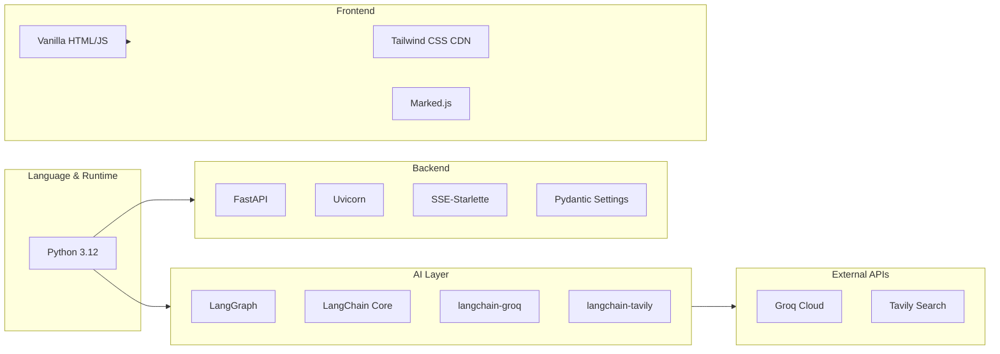

# Technology and Architecture Decisions

This document explains why each major technology was selected. Where the original reasoning cannot be established from the codebase, justifications are labeled as **architectural justification** rather than confirmed historical decisions.

## Decision Summary

---

## 1. Programming Language — Python 3.12

| Aspect | Detail |
|---|---|
| **Selected** | Python 3.12 |
| **Purpose** | Sole backend language |
| **Justification** | *Architectural.* Python is the dominant language in the LLM/AI ecosystem. LangChain, LangGraph, and all LLM provider SDKs are Python-first. `async`/`await` support enables efficient I/O-bound concurrency for API calls. |

| Alternative | Why Not Selected |
|---|---|
| Node.js / TypeScript | LangGraph and LangChain have limited JS support; Python ecosystem is more mature for multi-agent patterns |
| Go / Rust | No LangGraph equivalent; LLM orchestration libraries are Python-first |

---

## 2. Backend Framework — FastAPI

| Aspect | Detail |
|---|---|
| **Selected** | FastAPI ≥ 0.115.0 |
| **Purpose** | HTTP server and API layer |
| **Justification** | *Architectural.* FastAPI's native `async` support aligns with LangGraph's async streaming. Built-in request validation via Pydantic. ASGI-native, enabling SSE via `sse-starlette`. |

| Feature | FastAPI | Django | Flask |
|---|---|---|---|
| Async-native | Yes | Partial (3.1+) | No (requires extensions) |
| SSE support | Via `sse-starlette` | Manual | Manual |
| Pydantic integration | Built-in | Separate | Separate |
| Auto API docs | Yes (Swagger/ReDoc) | No | No |
| Minimal boilerplate | Yes | No (ORM, middleware, etc.) | Yes |
| **Fit for this project** | **Best** | Overkill | Lacks async |

**Trade-offs:** FastAPI does not include an ORM, template engine, or admin panel — none of which this application needs.

---

## 3. ASGI Server — Uvicorn

| Aspect | Detail |
|---|---|
| **Selected** | Uvicorn ≥ 0.30.0 (with `standard` extras) |
| **Purpose** | ASGI server to run the FastAPI application |
| **Justification** | *Architectural.* Uvicorn is the recommended ASGI server for FastAPI. The `standard` extras include `uvloop` and `httptools` for high-performance async I/O. |

---

## 4. SSE Library — SSE-Starlette

| Aspect | Detail |
|---|---|
| **Selected** | sse-starlette ≥ 2.1.0 |
| **Purpose** | Server-Sent Events streaming from FastAPI |
| **Justification** | *Architectural.* The application needs to stream agent progress events to the browser in real time. SSE is simpler than WebSockets for unidirectional server-to-client streaming. `sse-starlette` integrates directly with FastAPI's async response model via `EventSourceResponse`. |

| Alternative | Why Not Selected |
|---|---|
| WebSockets | Bidirectional communication not needed; SSE is simpler and works through standard HTTP |
| Long polling | Higher latency and overhead for real-time updates |
| HTTP streaming (chunked) | No built-in event types or reconnection semantics |

---

## 5. AI Orchestration — LangGraph

| Aspect | Detail |
|---|---|
| **Selected** | LangGraph ≥ 0.2.60 |
| **Purpose** | Multi-agent workflow orchestration |
| **Justification** | *Architectural.* LangGraph provides `StateGraph` for defining agent workflows as directed graphs, `Send` for parallel fan-out, `Annotated` reducers for concurrent state merging, conditional routing, and built-in streaming via `get_stream_writer()`. These features map directly to the research swarm's requirements. |

| Feature | LangGraph | Sequential LangChain Chain | CrewAI | AutoGen |
|---|---|---|---|---|
| Graph-based workflow | Yes (`StateGraph`) | No (linear) | No (task-based) | No (conversation-based) |
| Parallel fan-out | Yes (`Send`) | No | Limited | Limited |
| State reducers | Yes (`Annotated`) | No | No | No |
| Conditional routing | Yes (conditional edges) | Limited | Limited | No |
| Streaming from nodes | Yes (`get_stream_writer`) | Limited | No | No |
| Retry loops | Yes (graph cycles) | No | Manual | Manual |
| **Fit for this project** | **Best** | Insufficient | Possible but less control | Possible but different model |

**Trade-offs:** LangGraph has a steeper learning curve than a simple chain. The graph definition requires understanding `StateGraph`, `Send`, reducers, and conditional edges. However, the research swarm requires all of these features.

---

## 6. LLM Provider — Groq

| Aspect | Detail |
|---|---|
| **Selected** | Groq via `langchain-groq` ≥ 0.2.0 |
| **Model** | `openai/gpt-oss-120b` (configurable via `GROQ_MODEL`) |
| **Purpose** | LLM inference for all agent reasoning |
| **Justification** | *Architectural.* Groq provides extremely fast inference latency via custom LPU hardware, which is critical for a multi-agent system making 4+ LLM calls per request. Free tier available for development. Compatible with LangChain's `ChatGroq` interface. |

| Provider | Latency | Free Tier | LangChain Integration |
|---|---|---|---|
| **Groq** | **Very low (LPU)** | **Yes** | **Yes (`langchain-groq`)** |
| OpenAI | Medium | No | Yes |
| Anthropic | Medium | No | Yes |
| Ollama (local) | Variable | N/A (local) | Yes |
| Google Gemini | Medium | Yes | Yes |

**Trade-offs:** Groq's model selection is narrower than OpenAI's. The configured model `openai/gpt-oss-120b` is a Groq-hosted model; availability depends on Groq's serving schedule. The `.env.example` notes that model IDs should be confirmed at the Groq console.

---

## 7. Web Search — Tavily

| Aspect | Detail |
|---|---|
| **Selected** | Tavily via `langchain-tavily` ≥ 0.1.0 |
| **Purpose** | Web search for research data |
| **Justification** | *Architectural.* Tavily is designed specifically for LLM applications — it returns structured results with titles, URLs, and content extracts ready for LLM consumption. Free tier available. First-class LangChain integration. |

| Search API | LLM-Optimized | Structured Output | Free Tier | LangChain Integration |
|---|---|---|---|---|
| **Tavily** | **Yes** | **Yes** | **Yes** | **Yes** |
| SerpAPI | No | Partial | Limited | Yes |
| Google Custom Search | No | Partial | Limited | Manual |
| Bing Search API | No | Partial | Limited | Manual |

**Trade-offs:** Tavily's free tier has rate limits. Results depend on Tavily's indexing coverage, which may differ from Google or Bing.

---

## 8. Configuration — Pydantic Settings

| Aspect | Detail |
|---|---|
| **Selected** | `pydantic-settings` ≥ 2.5.0 + `python-dotenv` ≥ 1.0.1 |
| **Purpose** | Environment-based configuration with type validation |
| **Justification** | *Architectural.* Pydantic Settings provides typed, validated configuration from environment variables and `.env` files. Integrates naturally with FastAPI (both Pydantic-based). Supports defaults, type coercion, and dot-env file loading. |

**Trade-offs:** Adds a dependency compared to raw `os.environ` reads, but provides type safety, default values, and `.env` file support in a single mechanism.

---

## 9. Frontend — Vanilla HTML + Tailwind CSS + Marked.js

| Aspect | Detail |
|---|---|
| **Selected** | Single HTML file, Tailwind CSS 3.4.13 (CDN), Marked.js 14.1.2 (CDN), Vanilla JavaScript |
| **Purpose** | User interface with real-time agent visualization |
| **Justification** | *Architectural.* The UI is simple enough (single page, no routing, no complex state) that a framework would add unnecessary complexity. CDN-loaded Tailwind and Marked.js avoid any build toolchain. The native `EventSource` API handles SSE without additional libraries. |

| Alternative | Why Not Selected |
|---|---|
| React / Vue / Svelte | Requires build toolchain (npm, webpack/vite); overkill for a single-page UI |
| Server-rendered templates (Jinja2) | Cannot handle real-time SSE updates elegantly |
| Streamlit / Gradio | Less control over UI design; opinionated layout |

**Trade-offs:** No component reusability, no virtual DOM diffing, no type checking in JS. The UI is intentionally minimal — 249 lines total — making these trade-offs acceptable.

---

## 10. Architecture Pattern — Stateless, In-Memory, Single-Process

| Aspect | Detail |
|---|---|
| **Selected** | No database, no queue, no background workers |
| **Purpose** | Simplicity for a research tool |
| **Justification** | *Architectural.* Each research request is self-contained: state lives in the LangGraph execution context and is discarded after the response. There is no need for persistence (no user accounts, no history), so a database would add unnecessary complexity. |

| Feature | Current Implementation | If Database Were Added |
|---|---|---|
| Research history | Not stored | Could persist past queries and reports |
| User accounts | Not implemented | Would require auth + session storage |
| Concurrent users | Supported (async) | Same (async) |
| Horizontal scaling | Not designed for | Would require shared state |

**Trade-offs:** No research history, no audit trail, no persistence across server restarts. These are acceptable for a development/research tool and could be added as future enhancements.
