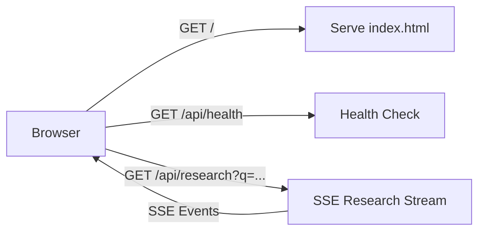
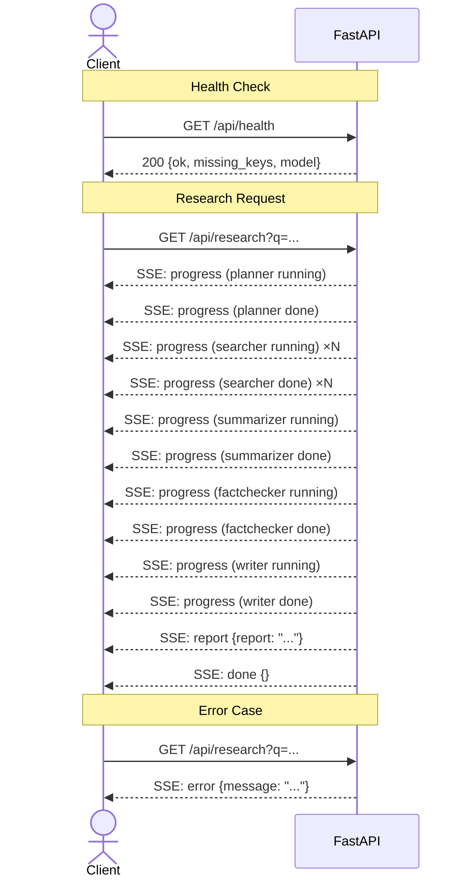

# API Documentation

## Overview

The application exposes three HTTP endpoints, all served by FastAPI via Uvicorn on `http://127.0.0.1:8000`.



> [!NOTE]
> There is no authentication, authorization, or rate limiting implemented. All endpoints are publicly accessible.

---

## Endpoints

### 1. `GET /` — Serve Frontend

| Attribute | Value |
|---|---|
| **Path** | `/` |
| **Method** | `GET` |
| **Handler** | `main.py:index()` |
| **Purpose** | Serves the single-page web UI |
| **Authentication** | None |

**Response:**

| Status | Content-Type | Body |
|---|---|---|
| `200` | `text/html` | Contents of `static/index.html` |

---

### 2. `GET /api/health` — Health Check

| Attribute | Value |
|---|---|
| **Path** | `/api/health` |
| **Method** | `GET` |
| **Handler** | `main.py:health()` |
| **Purpose** | Reports whether required API keys are configured and which model is active |
| **Authentication** | None |

**Response:**

| Status | Content-Type |
|---|---|
| `200` | `application/json` |

**Response body:**

```json
{
  "ok": true,
  "missing_keys": [],
  "model": "openai/gpt-oss-120b"
}
```

**Field descriptions:**

| Field | Type | Description |
|---|---|---|
| `ok` | `boolean` | `true` if both `GROQ_API_KEY` and `TAVILY_API_KEY` are present |
| `missing_keys` | `string[]` | List of missing key names (e.g., `["GROQ_API_KEY"]`); empty if `ok` is `true` |
| `model` | `string` | Configured Groq model identifier |

**Example — keys missing:**

```json
{
  "ok": false,
  "missing_keys": ["GROQ_API_KEY", "TAVILY_API_KEY"],
  "model": "openai/gpt-oss-120b"
}
```

---

### 3. `GET /api/research` — Research Stream (SSE)

| Attribute | Value |
|---|---|
| **Path** | `/api/research` |
| **Method** | `GET` |
| **Handler** | `main.py:research()` |
| **Purpose** | Executes the multi-agent research pipeline and streams progress + results via Server-Sent Events |
| **Authentication** | None |

**Query Parameters:**

| Parameter | Type | Required | Constraints | Description |
|---|---|---|---|---|
| `q` | `string` | Yes | `min_length=3` | The research question |

**Validation errors:**

| Condition | Status | Response |
|---|---|---|
| `q` parameter missing | `422` | FastAPI validation error (Pydantic) |
| `q` shorter than 3 characters | `422` | FastAPI validation error (Pydantic) |

**SSE Event Types:**

The endpoint returns `text/event-stream` content. Four named event types are emitted:

#### Event: `progress`

Emitted each time an agent changes status. Multiple `progress` events are sent per request.

```
event: progress
data: {"agent": "planner", "status": "running", "message": "Planning research for: ...", "data": null}
```

| Field | Type | Values | Description |
|---|---|---|---|
| `agent` | `string` | `"planner"`, `"searcher"`, `"summarizer"`, `"factchecker"`, `"writer"` | Which agent emitted the event |
| `status` | `string` | `"running"`, `"done"`, `"error"` | Agent's current status |
| `message` | `string` | — | Human-readable progress description |
| `data` | `any \| null` | — | Optional payload (e.g., sub-questions list, sources list) |

**Example progress events in order:**

```
event: progress
data: {"agent":"planner","status":"running","message":"Planning research for: What is quantum computing?"}

event: progress
data: {"agent":"planner","status":"done","message":"Drafted 3 sub-question(s)","data":["What are the basic principles of quantum computing?","What are current quantum computing applications?","What are the challenges facing quantum computing?"]}

event: progress
data: {"agent":"searcher","status":"running","message":"Searching: What are the basic principles of quantum computing?"}

event: progress
data: {"agent":"searcher","status":"done","message":"Found 5 source(s) for: What are the basic principles of quantum computing?","data":[{"title":"...","url":"..."}]}

event: progress
data: {"agent":"summarizer","status":"running","message":"Summarizing findings from all searches"}

event: progress
data: {"agent":"summarizer","status":"done","message":"Key findings compiled"}

event: progress
data: {"agent":"factchecker","status":"running","message":"Verifying claims against sources"}

event: progress
data: {"agent":"factchecker","status":"done","message":"Verdict: pass"}

event: progress
data: {"agent":"writer","status":"running","message":"Writing final report"}

event: progress
data: {"agent":"writer","status":"done","message":"Report ready"}
```

#### Event: `report`

Emitted once when the Writer agent completes. Contains the final Markdown report.

```
event: report
data: {"report": "# Research Report\n\n## Key Findings\n\n- ..."}
```

| Field | Type | Description |
|---|---|---|
| `report` | `string` | Complete Markdown-formatted research report with citations |

#### Event: `done`

Emitted once after the graph stream is exhausted. Signals successful completion.

```
event: done
data: {}
```

#### Event: `error`

Emitted when an error occurs. The stream ends after this event.

```
event: error
data: {"message": "Missing API keys: GROQ_API_KEY. Add them to your .env file."}
```

| Field | Type | Description |
|---|---|---|
| `message` | `string` | Human-readable error description |

**Error conditions:**

| Condition | Error Message Pattern |
|---|---|
| Missing API keys | `"Missing API keys: GROQ_API_KEY, TAVILY_API_KEY. Add them to your .env file."` |
| LLM API failure | Exception message from `langchain-groq` |
| Tavily API failure | Exception message from `langchain-tavily` (search-level; non-fatal to pipeline) |
| Any unhandled exception | `str(exc)` of the caught exception |

---

## Static Assets

| Path | Served From | Description |
|---|---|---|
| `/static/*` | `static/` directory | Static file mount (currently only `index.html`) |

---

## API Interaction Flow


