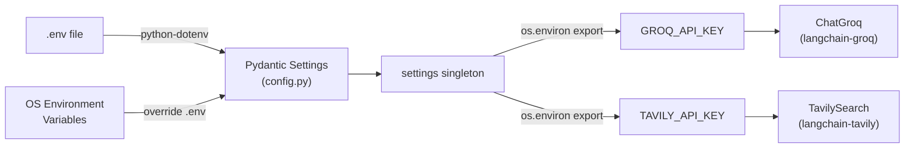
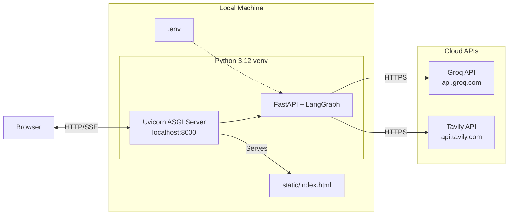

# Deployment and Configuration

## Environment Setup

### Prerequisites

| Requirement | Version | Purpose |
|---|---|---|
| Python | 3.12+ | Runtime |
| pip | Latest | Package manager |
| Groq API Key | — | LLM inference |
| Tavily API Key | — | Web search |

### Local Development Setup

1. **Clone the repository**

   ```bash
   git clone <repository-url>
   cd MultiAgent
   ```

2. **Create a virtual environment**

   ```powershell
   # Windows PowerShell
   python -m venv .venv
   .\.venv\Scripts\Activate.ps1
   ```

   ```bash
   # macOS / Linux
   python -m venv .venv
   source .venv/bin/activate
   ```

3. **Install dependencies**

   ```bash
   pip install -r requirements.txt
   ```

4. **Configure environment variables**

   ```bash
   cp .env.example .env
   # Edit .env and add your API keys
   ```

5. **Start the server**

   ```bash
   uvicorn app.main:app --reload
   ```

6. **Open the application**

   Navigate to [http://127.0.0.1:8000](http://127.0.0.1:8000)

7. **Verify configuration**

   Navigate to [http://127.0.0.1:8000/api/health](http://127.0.0.1:8000/api/health) to confirm API keys are loaded.

### Backend-Only Smoke Test

Run without the web UI:

```bash
python -m app.graph
```

This executes a hardcoded question ("What are the main approaches to carbon capture and their trade-offs?") and prints agent progress and the report to stdout.

---

## Required Dependencies

All dependencies are specified in `requirements.txt`:

| Package | Version Constraint | Purpose |
|---|---|---|
| `langgraph` | ≥ 0.2.60 | Multi-agent graph orchestration |
| `langchain-core` | ≥ 0.3.30 | Core LangChain abstractions (messages, tools) |
| `langchain-groq` | ≥ 0.2.0 | ChatGroq LLM integration |
| `langchain-tavily` | ≥ 0.1.0 | Tavily web search tool |
| `fastapi` | ≥ 0.115.0 | Web framework |
| `uvicorn[standard]` | ≥ 0.30.0 | ASGI server (includes uvloop, httptools) |
| `sse-starlette` | ≥ 2.1.0 | Server-Sent Events for FastAPI |
| `pydantic-settings` | ≥ 2.5.0 | Typed environment configuration |
| `python-dotenv` | ≥ 1.0.1 | `.env` file loading |

---

## Environment Variables

All configuration is managed through environment variables, loaded from a `.env` file by Pydantic Settings.

| Variable | Required | Default | Description |
|---|---|---|---|
| `GROQ_API_KEY` | Yes | `""` | Groq API key for LLM inference. Obtain at https://console.groq.com/keys |
| `TAVILY_API_KEY` | Yes | `""` | Tavily API key for web search. Obtain at https://app.tavily.com/ |
| `GROQ_MODEL` | No | `openai/gpt-oss-120b` | Groq model identifier. Verify at https://console.groq.com/docs/models |
| `TEMPERATURE` | No | `0.3` | LLM generation temperature (0.0–1.0) |
| `MAX_SEARCH_RESULTS` | No | `5` | Number of Tavily results per search query |
| `MAX_SUBQUESTIONS` | No | `5` | Maximum sub-questions the Planner can generate |
| `MAX_FACTCHECK_RETRIES` | No | `1` | Maximum fact-check retry loops before proceeding to Writer |

> [!CAUTION]
> Never commit the `.env` file to version control. It is listed in `.gitignore`. Use `.env.example` as a template.

### Example `.env` file

```bash
# API Keys
GROQ_API_KEY=your_groq_api_key_here
TAVILY_API_KEY=your_tavily_api_key_here

# Model Configuration
GROQ_MODEL=openai/gpt-oss-120b

# Optional Tuning
TEMPERATURE=0.3
MAX_SEARCH_RESULTS=5
MAX_SUBQUESTIONS=5
MAX_FACTCHECK_RETRIES=1
```

---

## Configuration Loading Flow



**Loading priority** (highest to lowest):
1. OS environment variables
2. `.env` file values
3. Default values in `Settings` class

---

## Deployment Architecture



> [!NOTE]
> The project does not include a Dockerfile, `docker-compose.yml`, CI/CD pipeline, or production deployment configuration. It is designed for local development use. Production deployment would require adding:
> - A production ASGI server configuration (Gunicorn with Uvicorn workers)
> - HTTPS termination (reverse proxy such as Nginx)
> - Container packaging (Dockerfile)
> - Secret management (vault or cloud-native secrets)

---

## Build and Startup Commands

| Action | Command |
|---|---|
| Install dependencies | `pip install -r requirements.txt` |
| Start dev server | `uvicorn app.main:app --reload` |
| Start dev server (custom port) | `uvicorn app.main:app --reload --port 8080` |
| Backend smoke test | `python -m app.graph` |
| Check health | `curl http://127.0.0.1:8000/api/health` |
