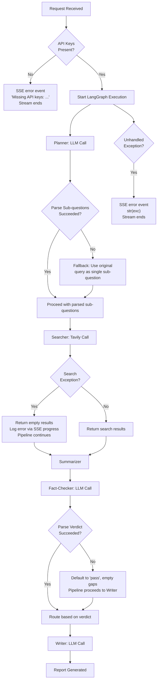
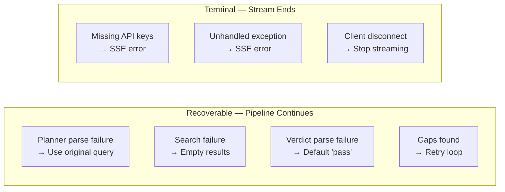

# Error Handling and Recovery

## Overview

The application implements a **graceful degradation** strategy: individual component failures do not crash the pipeline. Errors are caught, logged via SSE progress events, and the pipeline continues with available data or reports the failure to the client.

## Error Handling Architecture



## Error Categories

### 1. Configuration Errors

| Error | Detection | Handling | Location |
|---|---|---|---|
| Missing `GROQ_API_KEY` | `settings.keys_present` returns `False` | SSE `error` event with specific missing key names | `main.py:event_gen()` |
| Missing `TAVILY_API_KEY` | `settings.keys_present` returns `False` | SSE `error` event with specific missing key names | `main.py:event_gen()` |
| Invalid model name | Groq API returns error at first LLM call | Caught by top-level exception handler | `main.py:event_gen()` |

### 2. Input Validation Errors

| Error | Detection | Handling | Location |
|---|---|---|---|
| Missing `q` parameter | FastAPI `Query(...)` required | HTTP `422` Unprocessable Entity | `main.py:research()` |
| `q` shorter than 3 chars | FastAPI `Query(..., min_length=3)` | HTTP `422` Unprocessable Entity | `main.py:research()` |
| `q` shorter than 3 chars (client) | JS check `query.length < 3` | Form not submitted; input focused | `index.html` |

### 3. LLM Response Parsing Errors

| Error | Detection | Handling | Location |
|---|---|---|---|
| Planner returns invalid JSON | `_extract_json()` returns `None` | `parse_subquestions()` falls back to line-splitting | `agents.py:92-97` |
| Planner returns empty list | Empty list check after parsing | Falls back to `[query]` (original question) | `agents.py:126-127` |
| Fact-Checker returns invalid JSON | `_extract_json()` returns `None` | `parse_verdict()` returns `("pass", [])` — pipeline proceeds to Writer | `agents.py:100-109` |
| LLM returns JSON in code fences | Regex strips ` ```json ``` ` wrapper | Transparent to callers | `agents.py:68-70` |
| LLM returns JSON embedded in prose | `_first_block()` extracts first `{...}` or `[...]` | Transparent to callers | `agents.py:73-79` |

### 4. External Service Failures

| Error | Detection | Handling | Location |
|---|---|---|---|
| Tavily search fails | `except Exception` in `searcher()` | Returns empty results `{content: "", sources: []}`, logs error via SSE progress, pipeline continues | `agents.py:142-145` |
| Groq API failure | Uncaught — propagates to top-level handler | SSE `error` event with exception message | `main.py:67-68` |
| Network timeout | Underlying `httpx`/`aiohttp` raises exception | Same as above — caught at top level or per-search | Depends on which call |

### 5. Client Disconnection

| Error | Detection | Handling | Location |
|---|---|---|---|
| Browser closes connection | `request.is_disconnected()` check in stream loop | Breaks the SSE generator loop, stopping graph execution | `main.py:54-55` |
| EventSource error | JS `error` event listener | Logs error, calls `finish()` to re-enable UI | `index.html:223-228` |

## Recovery Mechanisms — Implemented

| Mechanism | Description | Location |
|---|---|---|
| **Sub-question fallback** | If Planner's LLM response cannot be parsed into sub-questions, the original query is used as a single sub-question | `agents.py:126-127` |
| **Search error tolerance** | Individual Tavily search failures return empty results instead of crashing the pipeline; the Summarizer and Writer work with whatever results are available | `agents.py:142-145` |
| **Verdict parse fallback** | If Fact-Checker's response cannot be parsed, the default `("pass", [])` verdict sends the pipeline to the Writer | `agents.py:100-109` |
| **Fact-check retry loop** | If the Fact-Checker identifies gaps, the pipeline loops back through Refine → Search → Summarize → Fact-Check, up to `MAX_FACTCHECK_RETRIES` times | `agents.py:267-273` |
| **Retry limit** | The retry loop is bounded by `max_factcheck_retries` (default 1) to prevent infinite loops | `config.py:34`, `agents.py:271` |
| **Top-level exception catch** | Any unhandled exception in the SSE generator is caught and reported to the client as an `error` event | `main.py:67-68` |
| **Client disconnect detection** | The SSE generator checks `request.is_disconnected()` on each iteration to stop wasting resources | `main.py:54-55` |

## Recovery Mechanisms — Not Implemented

The following are **not currently implemented** and represent potential improvements:

| Mechanism | Current Behavior | Potential Improvement |
|---|---|---|
| LLM call retry with backoff | Single attempt; failure propagates | Retry with exponential backoff for transient Groq API errors |
| Tavily search retry | Single attempt; returns empty on failure | Retry with backoff before falling back to empty |
| Rate limit handling | Groq/Tavily rate limit errors propagate as exceptions | Detect HTTP 429, wait for `Retry-After`, and retry |
| Circuit breaker | No circuit breaker pattern | Stop sending requests to a service that has failed repeatedly |
| Structured logging | No logging framework | Add Python `logging` with structured JSON output |
| Error alerting | Errors only visible in browser UI | Send alerts to monitoring system on repeated failures |
| Request timeout | No explicit timeout on graph execution | Add configurable timeout to prevent long-running requests |
| Partial results | If Writer LLM call fails, no report is generated | Could save and display partial findings from Summarizer |

## Failure Handling Summary


