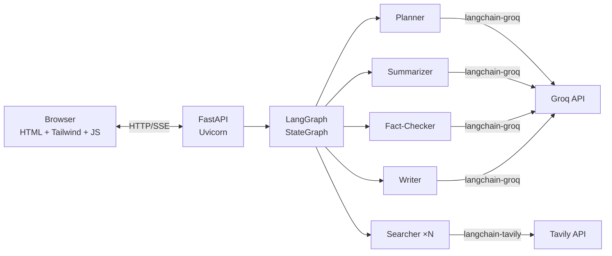

# Research Assistant Swarm — Documentation

## Project Overview

A multi-agent research system where a team of specialized AI agents — Planner, Searcher, Summarizer, Fact-Checker, and Writer — collaborate to research a topic, verify findings, and produce a cited Markdown report. Built with LangGraph for orchestration, Groq for LLM inference, Tavily for web search, and FastAPI for real-time SSE streaming.

## Architecture



## Technology Stack

| Layer | Technology |
|---|---|
| Frontend | HTML, Tailwind CSS 3.4.13, Vanilla JS, Marked.js 14.1.2 |
| Backend | Python 3.12, FastAPI, Uvicorn, SSE-Starlette |
| AI Orchestration | LangGraph (StateGraph, Send fan-out, reducers) |
| LLM | Groq (ChatGroq) — `openai/gpt-oss-120b` |
| Web Search | Tavily (TavilySearch) |
| Configuration | Pydantic Settings, python-dotenv |

## Documentation Index

Read the documents in order for a complete understanding of the system:

| # | Document | Description |
|---|---|---|
| 1 | [System Overview](01-system-overview.md) | Problem statement, objectives, key features, target users, technology stack |
| 2 | [End-to-End Flow](02-end-to-end-flow.md) | Complete request lifecycle with flowcharts and sequence diagrams |
| 3 | [System Architecture](03-system-architecture.md) | Frontend, backend, AI orchestration, state, and deployment architecture |
| 4 | [Technical Documentation](04-technical-documentation.md) | Module-by-module implementation details, data validation, prompt management |
| 5 | [Technology Decisions](05-technology-decisions.md) | Why each technology was selected, with alternatives comparison |
| 6 | [API Documentation](06-api-documentation.md) | All HTTP endpoints with request/response schemas and SSE event types |
| 7 | [Deployment & Configuration](07-deployment-and-configuration.md) | Setup instructions, environment variables, build commands |
| 8 | [Error Handling & Recovery](08-error-handling-and-recovery.md) | Failure modes, recovery mechanisms, and improvement recommendations |

## Diagrams

All Mermaid diagram sources are in the [`diagrams/`](diagrams/) directory:

| Diagram | File |
|---|---|
| System Architecture | [system-architecture.mmd](diagrams/system-architecture.mmd) |
| End-to-End Flow | [end-to-end-flow.mmd](diagrams/end-to-end-flow.mmd) |
| AI Workflow | [ai-workflow.mmd](diagrams/ai-workflow.mmd) |
| Sequence Diagram | [sequence-diagram.mmd](diagrams/sequence-diagram.mmd) |
| Deployment Architecture | [deployment-architecture.mmd](diagrams/deployment-architecture.mmd) |

## Quick Start

```bash
# 1. Setup
python -m venv .venv && .venv\Scripts\Activate.ps1  # Windows
pip install -r requirements.txt

# 2. Configure
cp .env.example .env
# Edit .env → add GROQ_API_KEY and TAVILY_API_KEY

# 3. Run
uvicorn app.main:app --reload

# 4. Open
# http://127.0.0.1:8000
```
